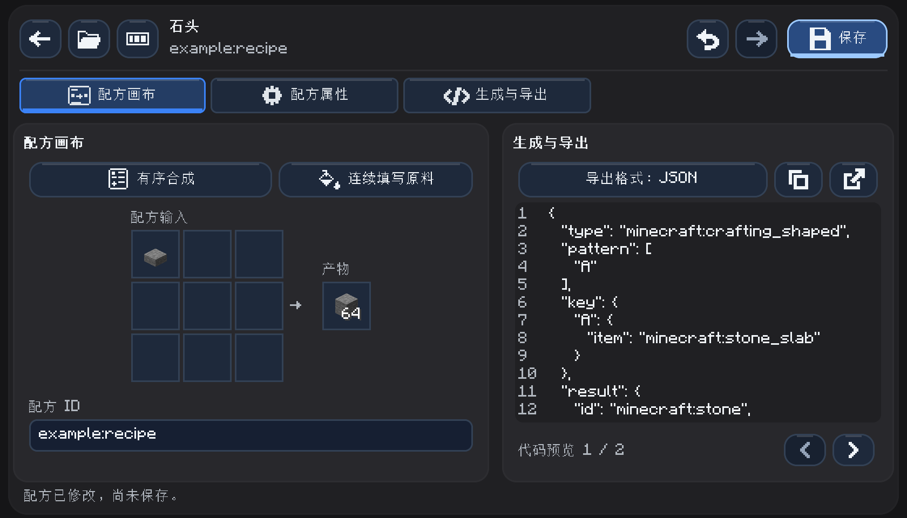
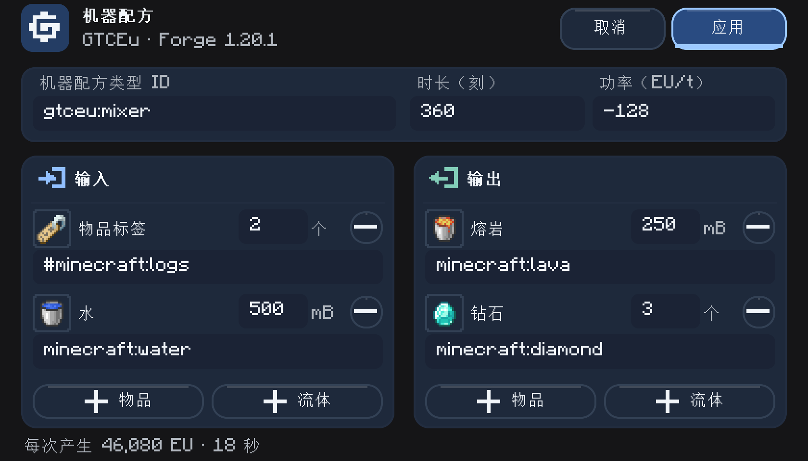
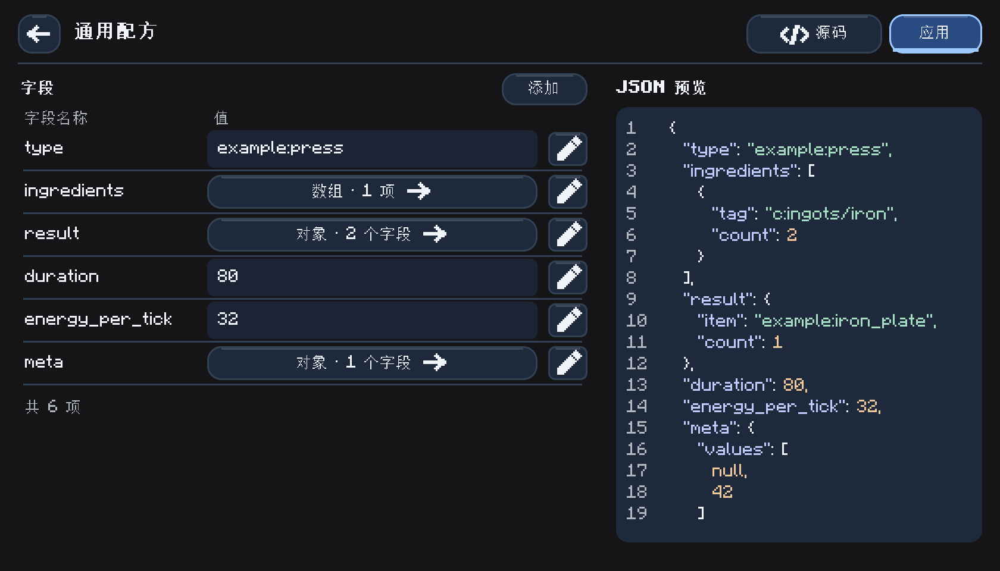

<!-- 作者：山海／dishanhai -->
# 可视化配方编辑器

在 F10 主控中心进入“设置 → 开发者 → 配方编辑器”。需要配套构建的 SH-Better-UI，提供 UUK 素材槽、工作台和多行代码编辑 API。旧 SHBUI 缺少这些能力时，入口显示更新提示，不影响其他主控页面。



## 支持范围

三个版本分别按自己的格式生成配方：Forge 1.20.1、NeoForge 1.21.1、NeoForge 26.1.2。

| 类型 | 编辑内容 |
| --- | --- |
| 有序、无序合成 | 3×3 原料、物品或标签、产物数量 |
| 熔炉、高炉、烟熏炉、营火 | 单个原料、产物、经验和耗时 |
| 切石 | 原料、产物和数量 |
| 锻造转换 | 模板、基底、添加材料和产物 |
| 锻造纹饰 | 模板、基底和添加材料；26.1.2 另需纹饰图案 ID |
| 药水酿造 | 基础药水 ID、物品或标签原料、产物药水 ID；保留瓶型 |
| 药水瓶型转换 | 输入瓶型物品、原料、输出瓶型物品；保留药水数据 |
| GTCEu 机器 | Forge 1.20.1 格式的机器类型、时长、EU/t、多项物品和流体输入输出 |
| 通用配方 | 任意序列化器的字段表、对象、数组、值和完整 JSON 源码 |

物品选择器仅选取物品注册 ID。需要 NBT、数据组件、多选原料或模组专属属性时，使用自定义 JSON；工具不会把 JEI 物品变体的附加数据隐式写入普通物品槽。26.1.2 选择器使用注册表默认物品形态，旧版本优先使用 SHBUI 提供的 JEI 目录。

## 操作

点击原料或产物槽直接打开资源选取器，参照 GTSH `MultiPickerScreen` 的左侧来源／模组、中间搜索网格、右侧已选清单和底部确认／取消结构。点击物品先修改本地选择，确认后回填配方；取消保留原内容。配方原料使用单选替换，产物可以调整数量。工具栏、来源与操作按钮使用 SHBUI 图标，物品名称与提示保留原生富文本样式和行内物品图标。

来源包括物品目录、玩家物品栏和可用的 JEI 物品书签；未安装／未就绪的 JEI、没有玩家的主菜单会显示空来源。物品目录优先采用 JEI 顺序，再用注册表补齐。搜索支持名称／ID、`@模组`、`#标签`、`*ID`、`$提示文本`，空格连接的条件同时满足；支持名称、模组、ID 和数量排序。高 GUI 缩放时保留三列布局，并将来源切换压缩为循环按钮。NeoForge 26.1.2 尚无 JEI 书签后端。需要同时更新本次构建的 SHCLIB 与 SHBUI。

“手填 ID”保留原料 ID／`#标签` 输入，点击“应用”写入画布。药水槽填写药水注册 ID，例如 `minecraft:awkward`；瓶型转换选择 `minecraft:potion`、`minecraft:splash_potion` 或 `minecraft:lingering_potion`。纹饰图案 ID 需在世界动态注册表可用后校验。选择器中的背包／书签原型保留 NBT／组件，但当前配方画布只写入物品 ID；需要复杂原料时使用自定义 JSON。

有序／无序合成可拖动交换原料。右键或 Delete 清空槽位，Enter 选择，方向键移动槽位焦点；Esc 取消拖放。工具栏提供撤销和重做。输入框保留其原生文字操作，页面历史使用独立按钮。

窗口较窄时可在画布、属性和生成页间切换。空间充足时，生成预览显示在编辑区右侧。切换类型前会显示确认，也可以撤销。离开时可以保存、继续或放弃。另存到已有草稿 ID 需要确认覆盖。

“导入”从剪贴板读取 JSON。已支持且能完整表示的原版／SHCLIB 酿造定义还原为画布，保留原版的 category 和 show_notification 信息；普通配方的未知字段、数据组件、复合原料或第三方类型会保留原文进入自定义编辑。酿造配置含不支持的扩展字段时拒绝导入，保留当前文档和剪贴板原文。工具不执行或反向解析任意 KubeJS JavaScript。

保存草稿可以保留尚未通过配方校验的内容；未能解析的数值需要先修正。复制和导出只允许当前有效文档，不会退回上一个有效结果。

### 编辑 GTCEu 机器配方

从画布的类型选择器选择「GTCEu 机器（Forge 1.20.1）」。例如在 `gtceu:mixer` 中设置时长 200 刻、功率 32 EU/t，分别添加物品或流体输入和输出。物品输入接受注册 ID 和 `#命名空间:标签`，流体量使用 mB。负 EU/t 表示发电。点击「应用」一次提交整页修改，可在工作区一步撤销。



三个客户端都能编写这种配方。导出的数据包使用 Forge 1.20.1 的 `data/<namespace>/recipes/<path>.json`。运行配方的目标实例需要安装相应机器类型和材料所属的模组。GTCEu 1.20.1 的 KubeJS 导出使用 KubeJS 6 的资源事件，将完整 ID 和 64 位能量值写入配方资源。

默认改用专用视图的范围是能完整表示的 `gtceu:*` 机器 JSON。带概率、条件、集成电路或其他扩展数据的配方在通用编辑器打开。跨版本作者模式会把 Forge 目标保存在这份通用草稿中。

### 编辑第三方配方

在「操作 → 导入」粘贴现有配方，或从类型选择器新建「通用配方」。在字段表中直接编辑文本和数值。点击对象或数组的数量可进入下一级。「添加」可建立文本、数字、布尔值、对象、数组或空值。「JSON 源码」可粘贴整份配方，也可用来修复未完成的草稿。

编辑时会保留其他字段、数组顺序和显式 `null`。窗口足够宽时，右栏随字段变化预览当前层级的 JSON。点击「应用」后返回工作区，草稿、撤销、复制和导出使用同一份文档。「属性 → 导出目标」可选择当前客户端或固定版本。固定版本决定资源目录，序列化器所需的具体字段由目标模组定义。



## 工作区与安装

默认根目录为实例内 `config/sh_common_lib/recipe_editor/`。

| 路径 | 用途 |
| --- | --- |
| `drafts/<namespace>/<path>.json` | 带 schema 版本的编辑草稿 |
| `exports/data/<namespace>/recipes/<path>.json` | 1.20.1 普通配方 |
| `exports/data/<namespace>/recipe/<path>.json` | 1.21.1／26.1.2 普通配方 |
| `exports/kubejs/server_scripts/<namespace>/<path>.js` | 普通配方的 KubeJS 脚本 |
| `exports/kubejs/startup_scripts/<namespace>/<path>.js` | 生成 SHCLIB 酿造配置的 KubeJS 启动脚本 |
| `exports/java/<namespace>/<path>/Recipe_<hash>.java` | 每个配方独立的 Java 资源生成器 |
| `brewing/<namespace>/<path>.json` | 服务端启动时读取的 SHCLIB 酿造配置 |

JSON 导出是配方资源文件，不是已安装的数据包 ZIP。将 `data/` 加入对应版本的数据包或模组资源，并自行提供匹配版本的 `pack.mcmeta`。普通 KubeJS 脚本复制到目标实例 `kubejs/server_scripts/` 并重载服务端脚本；酿造脚本复制到 `kubejs/startup_scripts/` 后重启实例。

Java 导出是可直接编译的资源生成工具类，调用其 `save(Path root)`。普通配方的 root 是直接包含 `data/` 的资源根目录；酿造的 root 是实例根目录。它会写出相应 JSON，不会自动注册配方，也不是任意模组的 RecipeBuilder 实现。多个不同配方使用不同类名，可同时编译。

酿造 JSON 由 SHCLIB 读取，可安装为实例配置，或放入数据包的 `data/<namespace>/sh_common_lib/brewing/<path>.json`。它不使用原版 `recipe/` 目录。示例：

```json
{
  "id": "example:awkward_to_swiftness",
  "input": "minecraft:awkward",
  "ingredient": "minecraft:sugar",
  "output": "minecraft:swiftness"
}
```

瓶型转换添加 `"kind": "container"`，input/output 改为瓶型物品 ID。未写 kind 按药水转换读取，原料可用 `#namespace:tag`。数据包文件可省略 id；提供时必须与资源路径推导的 ID 一致。独立服务器需安装 SHCLIB，在服务端安装配置／数据包或运行生成脚本，再执行 `/reload`。同一 ID 的优先级为数据包、实例配置、程序注册；相同数据包资源路径遵循原版包优先级。不同 ID 的相同输入／原料按加载器的酿造注册顺序匹配，不保证覆盖原版或其他模组。

客户端酿造原料槽 Mixin 允许将材料送交服务端检查，实际合法性仍由服务端快照决定，不改变燃料、瓶位或消耗规则。损坏／超限 JSON 逐条记录并跳过；资源管理器／配置目录整体读取失败会保留该监听器原快照，不保证整个服务端所有重载监听器的全局回滚。

草稿与导出有大小及路径边界检查。导出已有同名文件时需要确认，写入失败保留当前编辑内容。

## ULK 与 UUK 边界

`api.ulk.recipe` 提供 `RecipeDocument`、`RecipeType`、`RecipeTarget`、`RecipeFormat`、`RecipeGenerator`、`RecipeImporter`、`RecipeWorkspace`。这些生成和存储 API 不依赖客户端 Screen 或 SHBUI。

```java
var doc = RecipeImporter.fromJson("example:my_recipe", json, RecipeTarget.NEOFORGE_1_21_1);
var issues = RecipeGenerator.validate(doc, RecipeTarget.NEOFORGE_1_21_1, RecipeFormat.KUBEJS);
if (issues.isEmpty()) {
    RecipeArtifact script = RecipeGenerator.generate(doc, RecipeTarget.NEOFORGE_1_21_1, RecipeFormat.KUBEJS);
    new RecipeWorkspace(workspaceRoot).export(script, false);
}
```

`api.client.ulk.RecipeRegistryValidation` 额外检查当前客户端物品、标签、药水与纹饰。无世界或标签未同步时，返回可区分的不可用状态。生成核心可以离线使用，因此结构校验与注册表校验是两个独立能力。

UUK 的 `UiIngredientSlots`、`UiCodeEditor`、`UiWorkbench` 提供通用界面能力，不依赖 SHCLIB 的配方文档。SHCLIB 按平台依赖独立 SHBUI JAR，不重复打包 UUK 实现。

其他模组可通过 ULK 的 `BrewingRecipe`、`BrewingRecipes` 注册、替换、移除和查询酿造定义；运行中变更在下一次酿造查询时生效。公开接口只使用 JDK 类型，示例与生命周期见 [酿造公共 API](BREWING_API.md)。

`RecipeDocument.rawJson` 在 CUSTOM 文档中保存完整原文；在可视化的原版文档中保存导入时的 category／show_notification 元信息。普通字段编辑保留元信息，确认切换类型时清空类型专属信息。

## 验证与限制

2026-11-19 在 NeoForge 1.21.1 隔离客户端通过了原版选料、通用嵌套字段修改与数组插入、GTCEu 双栏编辑、取消、撤销和 JSON 复制。Forge 47.4.16 测试服务端加载了 GTCEu 1.4.4、KubeJS 6 和 Rhino，通过 RecipeManager 按原始 ID 读回数据包、GT 专用脚本和通用 GT 脚本提供的三份机器配方。实测覆盖物品标签、流体量、脚本特殊字符以及 `9007199254740993` EU/t。

相关 Gradle 验证任务为 `recipeEditorTest`、`recipeImporterTest`、`brewingDefinitionsTest`、`brewingDatapackTest`、`brewingApiTest`、`brewingRuleCacheTest`，均挂入 `check`。覆盖版本格式、生成 Java 编译与执行、JSON 导入保真、草稿存取、路径边界、数据包合并与公开注册 API。UUK 有独立拖放、资源选择草稿／过滤／布局和主题资源验证。

NeoForge 1.21.1 的原生客户端回归可从该模块目录运行 `./gradlew -I ../gradle/recipe-editor-smoke.init.gradle runClient --no-daemon`。它使用隔离目录 `build/recipe-editor-smoke/`，检查 GUI 缩放 4／3 的槽位点击、搜索、暂存／连续选择、确认回填、产物数量／非法数量／取消、手填标签和属性页，并显式加载酿造原料槽以验证客户端 Mixin 可应用。输出截图与结果后自动关闭，测试源码只通过此初始化脚本加入，不进入正式 JAR。

构建不替代客户端验收。实际 GUI 缩放、拖放、主题、旁白、JEI 共存、KubeJS 启动、数据包加载以及单人／独立服务器酿造仍按 `TODO.md` 验收。

2026-11-16 的 NeoForge 1.21.1 隔离客户端通过上述流程，实际逻辑视口为 420×240／缩放 4 与 560×320／缩放 3；截图复核中文名称、行内物品和按钮图标可见。320×180 只完成纯布局边界测试。另以三个版本正式 JAR 单独编译第三方酿造 API 调用，编译类路径无需 Minecraft／加载器／Gson；这不代表真实第三方模组的运行时酿造已验收。

界面交互参考 [Crafting Generator](https://github.com/destruc7i0n/crafting) 的配方拖放及导出组织，版本化生成参考 [Misode](https://github.com/misode/misode.github.io)。实际渲染和控件使用项目 UUK。

## 界面设计参考

工作区宽度充足时并排展示编辑区与生成结果，宽屏增加侧栏。窄屏使用分段导航，当前页、键盘焦点和主要操作均服从玩家选择的 UUK 主题。分栏行为参考 [Apple Split Views](https://developer.apple.com/design/human-interface-guidelines/split-views) 和 [Ionic Split Pane](https://ionicframework.com/docs/api/split-pane)。

字段名、可编辑值和子项入口按列对齐，常用改动可在当前行完成。控件分组和选中态参考 [Konsta UI List](https://konstaui.com/react/list) 与 [Framework7 Segmented](https://framework7.io/docs/segmented)。游戏内界面由 UUK 原生控件组成。
